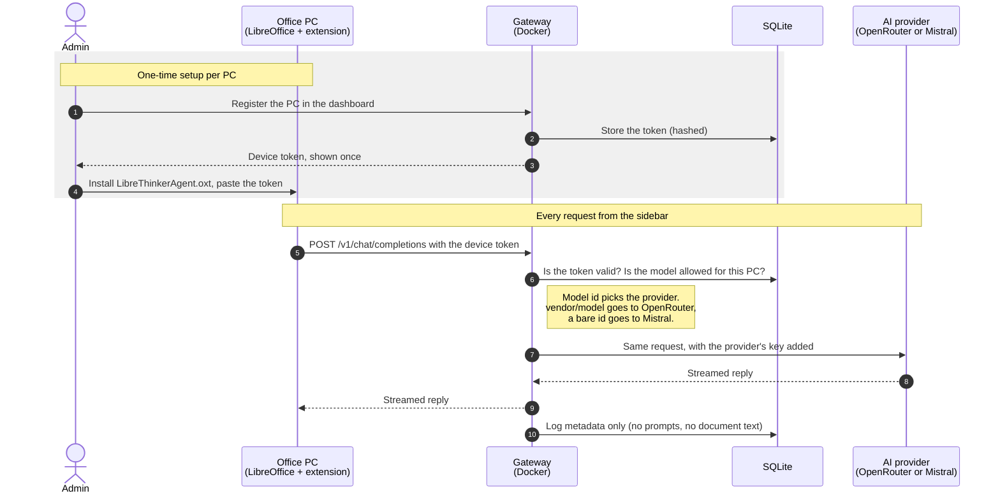

<p align="center"></p>

# Libre Thinker Agent

AI assistance in LibreOffice **Calc** and **Writer** for an office LAN, in the spirit of
Gemini in Google Sheets and Docs, without giving any employee a copy of the AI provider's API key.

Libre Thinker Agent is a small self-hosted gateway, plus a patched build of the
[WriterAgent](https://github.com/KeithCu/writeragent) extension that it hands out to office PCs.
Employees ask questions and give instructions in a sidebar; the extension talks only to the
gateway, and only the gateway holds the provider key (OpenRouter and/or Mistral).

---

## Contents

- [How is this different from WriterAgent?](#in-simple-words-how-is-this-different-from-writeragent)
- [Features](#features)
- [How it works](#how-it-works)
- [Requirements](#requirements)
- [Quick start](#quick-start)
- [Deploying to a server](#deploying-to-a-server)
- [Setting up office PCs](#setting-up-office-pcs)
- [Verifying the setup](#verifying-the-setup)
- [Configuration reference](#configuration-reference)
- [Models and providers](#models-and-providers)
- [Admin dashboard](#admin-dashboard)
- [Security notes](#security-notes)
- [Troubleshooting](#troubleshooting)
- [Limitations and roadmap](#limitations-and-roadmap)
- [Licence](#licence)

More detail: [Tested behaviour](docs/tested-behaviour.md) · [Changes to WriterAgent](docs/technical-changes.md) ·
[Gateway API and repository layout](docs/reference.md) · [Office PC setup options](docs/office-pc-setup.md) ·
[Model benchmark](BENCHMARK.md)

---

## In simple words: how is this different from WriterAgent?

**WriterAgent** is a free LibreOffice extension that adds an AI chat to Writer and Calc. It is made
for one person: you install it, paste in your own AI provider key, and it works on your computer.
Libre Thinker Agent is built on top of it. The AI engine and the document tools are still
WriterAgent's. We add two things around it: a **company gateway** (so a whole office can use it
safely) and **fixes and tuning** (so the answers are right on everyday office files).

### What a company gets that WriterAgent alone does not

| With WriterAgent alone | With Libre Thinker Agent |
| --- | --- |
| Every person needs an AI key, and the key sits on their PC. | Nobody has the key. It stays on one server (the gateway). |
| If a PC is lost or someone leaves, you must replace the key for everyone. | Each PC has its own token. Switch off one PC and the rest keep working. |
| Anyone can pick any model and spend any amount. | You choose which models each PC may use. |
| You cannot see who used the AI or what it cost. Each PC talks straight to the provider. | Every request goes through the gateway. A dashboard shows usage and real cost per day, per model and per PC, and failed requests. It records who called which model and when, never the document text. (The provider still receives the prompt, as before.) |
| Setup is a manual job on every PC. | Install one file and paste a token, or run one generated script. |
| WriterAgent checks its own update feed, so PCs can end up on different versions. | The update feed is removed. IT decides which version the PCs run. |
| One provider at a time. | OpenRouter and Mistral models behind one address, with automatic retries on short network failures. |

### What a user gets that WriterAgent alone does not

| Area | WriterAgent alone | Libre Thinker Agent |
| --- | --- | --- |
| Calc: understanding the sheet | Sees only the size of the sheet and the first row. It guesses, or reads the data a few cells at a time. | Sees the whole sheet, with exact totals, counts and dates worked out for it. "Who owes the most?" is answered correctly in one reply. |
| Calc: sorting | Sort did nothing and gave no error. | Sorting works. |
| Calc: formatting | Could not set number formats (thousands separators, currency) or freeze the header row. | Can do both. |
| Writer: reading the document | Missed text that comes after a table, so it sometimes deleted parts it could not see. | Reads the full text. |
| Writer: long rewrites and translations | Could go paragraph by paragraph and stop half-way. | Does them in one go and warns if a rewrite dropped a passage. |
| Speed | Spent many steps on colours and styling before doing the request. | Does the request first. Simple questions take one step. |
| Size of document it can see | About 8,000 characters. | 60,000 characters, enough for a long report or a whole working sheet. |
| What you see in the sidebar | Developer messages, the model's thinking, and about 24 buttons. | Plain progress lines ("Writing to O1:R6...") and a few buttons. |
| Memory | One shared memory file that carried a preference from one document into others. | Off. Chat history stays with each document. |

### What stays the same

The tools that change the document (cells, formulas, charts, styles, tables, tracked changes) are
WriterAgent's, the extension keeps WriterAgent's internal ID so it installs over an existing
WriterAgent, and WriterAgent's GPLv3 licence applies (see [Licence](#licence)). The exact list of
changes is in [docs/technical-changes.md](docs/technical-changes.md).

---

## Features

What Libre Thinker Agent offers today. Typical requests: "Summarise this sheet for management", "Add a VAT column", "Fix the spelling in this memo", "Turn these notes into meeting minutes". Ready-made test files are in [`samples/`](samples/). "Tested" means it passed the automatic end-to-end checks described in
[Tested behaviour](docs/tested-behaviour.md) and [BENCHMARK.md](BENCHMARK.md).

### Calc

| Area | What it does | Status |
| --- | --- | --- |
| Questions | Totals, counts, averages and "who owes the most?" answered from exactly computed figures, without touching the sheet. Management summaries, filtered counts (for example one region in one month), revenue per month. | Tested |
| Formulas | Adds columns such as VAT and "Total incl. VAT" as live formulas down every row, adds a totals row, builds a new summary sheet whose formulas point at the data. | Tested |
| Data | Sorts by a column with rows kept intact, highlights rows by a condition (for example all unpaid invoices). | Tested |
| Formatting | Bold or coloured headers, thousands separators and currency formats (for example `[$৳-445] #,##0`), frozen header row. | Tested |
| Charts | Bar and other charts from a prompt, such as revenue by region or amounts by category. | Tested |
| Other sheets | Sees the other sheets of the open workbook and can read them on request. | Tested |
| Pivot tables, forecasts, named ranges, filters, cell comments | Present in the underlying extension. | Not tested |

### Writer

| Area | What it does | Status |
| --- | --- | --- |
| Questions | Summarises a long report, answers "who is responsible for X and by when?", all without changing the document. | Tested |
| Drafting | Turns rough notes into meeting minutes with an action-items table, writes a formal letter from bullet points, adds an executive summary at the top. | Tested |
| Editing | Fixes spelling and grammar across a memo, rewrites one paragraph more formally and leaves the rest alone, translates a memo or report (including tables) into Bangla, finds and replaces across the whole document. | Tested |
| Formatting | Applies Title and Heading styles to plain text, adds a table in the right section. | Tested |
| Tracked changes, comments, images, headers and footers | Present in the underlying extension. | Not tested |

### Platform and administration

- Provider keys stay on the gateway; each PC has its own revocable token, and a PC can be limited to
  chosen models.
- Models from OpenRouter (`vendor/model`) and Mistral (bare ids) behind one OpenAI-compatible endpoint,
  with retries on short network failures.
- Install by one `.oxt` file plus a pasted token, or one generated setup script.
- Live admin dashboard: spend by day, by model and by PC, real billed cost with prompt-cache detail,
  latency percentiles, recent requests, a full filterable request log, and an archive of revoked PCs.
- Request metadata only is stored; prompts and document text never are.
- Plain-language progress lines in the sidebar ("Writing to O1:R6...") instead of tool names.

---

## How it works



Only the gateway ever holds the provider key. It retries brief network failures and never stores
prompts or document text.

WriterAgent reads its settings from `writeragent.json` in the LibreOffice profile and re-reads it
within seconds of a change, so central changes apply without restarting LibreOffice.

### Why not just put the key on each PC?

The key would then live in every employee's home directory in plain text, be copied into backups,
and be impossible to revoke per person. A gateway keeps the key in one place, lets you revoke a
single PC, and lets you change model or provider centrally.

---

## Requirements

| Component | Requirement |
| --- | --- |
| Gateway host | Any Linux machine with Docker and Docker Compose |
| Gateway network | Reachable from office PCs on the LAN; **do not expose it to the internet** |
| Office PCs | Linux or Windows with LibreOffice **24.8 or newer** |
| Office PC tooling | Nothing for the token-entry route; `bash` and `curl` for `setup.sh`; Python 3.8+ only for `provision_pc.py` |
| AI provider | An [OpenRouter](https://openrouter.ai) key with credit, and/or a Mistral API key |

LibreOffice 24.8 is mandatory: on an older version (for example 24.2, the default on Ubuntu 24.04)
the install fails with `unsatisfied dependencies`. On Ubuntu and Ubuntu-based systems (Linux Mint,
Zorin, Pop!_OS) the one-command `setup.sh` upgrades LibreOffice itself. Details and manual fixes are in
[docs/office-pc-setup.md](docs/office-pc-setup.md#libreoffice-version-and-python-on-the-pc).

---

## Quick start

### 1. Configure and start the gateway

```bash
cd gateway
cp .env.example .env
```

Edit **`gateway/.env`** (Docker reads only this file; a `.env` in the repository root is ignored)
and set at least:

```dotenv
OPENROUTER_API_KEY=sk-or-v1-...        # and/or MISTRAL_API_KEY=...
LIBRETHINKERAGENT_ADMIN_TOKEN=a-long-random-string
```

Generate the admin token with `python3 -c "import secrets; print(secrets.token_urlsafe(32))"`.

```bash
docker compose up -d --build
docker compose ps          # expect "healthy"
```

After editing `.env` later, apply it with `docker compose up -d --force-recreate`.

### 2. Find the gateway address

```bash
hostname -I
```

Use the address on the office LAN (for example `192.168.1.20`). From another PC:

```bash
curl http://<gateway-ip>:8080/healthz     # {"ok":true}
```

If that times out, open the firewall: `sudo ufw allow 8080/tcp`. Give the gateway a static DHCP
lease or a DNS name so its address does not change.

### 3. Register a PC

Open `http://<gateway-ip>:8080/`, paste the admin token, enter a PC name, and click
**Create token**. Leave all models ticked unless the PC should be restricted. The token is shown
**once**; only its hash is stored.

### 4. Set up the PC

See [Setting up office PCs](#setting-up-office-pcs). The quickest route: install `LibreThinkerAgent.oxt`,
restart LibreOffice, and paste the token under **Tools → Libre Thinker Agent: Enter access token…**.

---

## Deploying to a server

1. **Get the code on the server.** `git clone <your-repo-url>` and `cd gateway`. Keep the whole
   repository: the compose file mounts `../vendor` (the pinned WriterAgent package).
2. **Configure.** `cp .env.example .env`, then set a provider key, a random admin token
   (`python3 -c "import secrets; print(secrets.token_urlsafe(32))"`) and
   `LIBRETHINKERAGENT_PUBLIC_URL`, the address the PCs will use.
3. **Network.** On a trusted LAN or VPN the defaults are fine. For TLS, set
   `LIBRETHINKERAGENT_BIND=127.0.0.1`, put a reverse proxy in front (Caddy shown) and use its
   `https://` address as the public URL:

   ```text
   agent.example.com {
       reverse_proxy 127.0.0.1:8080
   }
   ```

4. **Start.** `docker compose up -d --build`, then `docker compose ps` should say `healthy`.
5. **Check.** `./smoke_test.sh http://<server>:8080` runs read-only checks (pages, auth refusal,
   extension download, security headers, admin API). Add `DEVICE_TOKEN=lta_... ` to also send one
   tiny chat request. It creates nothing, so it leaves no test devices behind.
6. **Back up.** `./backup.sh` writes a consistent database snapshot to `gateway/backups/` and keeps the
   newest 14; run it from cron, e.g. `0 2 * * * cd /opt/libre-agent/gateway && ./backup.sh`.
7. **Update.** `git pull && docker compose up -d --build`. Data lives in the compose volume and
   survives rebuilds. Then reinstall the extension on PCs only if it changed.
8. **Logs.** `docker compose logs -f --tail=50`. Container logs rotate (3 files of 10 MB).

---

## Setting up office PCs

Close LibreOffice on the PC first. The simplest route needs no command line:

1. Download `LibreThinkerAgent.oxt` from `http://<gateway-ip>:8080/setup/LibreThinkerAgent.oxt`
   (the dashboard links it under each new token). It is identical for every PC and contains no secret.
2. Double-click it (or **Tools → Extension Manager → Add**) and restart LibreOffice.
3. Open **Tools → Libre Thinker Agent: Enter access token…** and paste the PC's token. The extension
   checks it with the gateway and configures itself.

**Linux, one command (recommended).** The dashboard shows this next to each new token:

```bash
curl -fsSL -H "Authorization: Bearer lta_..." http://<gateway-ip>:8080/setup.sh | bash
```

Close LibreOffice first. The script prepares LibreOffice and installs the agent; on a PC that already
has LibreOffice 24.8+ it takes seconds, and when LibreOffice must be upgraded it takes several
minutes and asks for the user's password. It is safe to re-run. What it does on the PC:

- Checks the gateway and the token before touching anything.
- On Ubuntu, Linux Mint and other Ubuntu-based systems: upgrades LibreOffice older than 24.8 from the
  official LibreOffice PPA, and adds what is missing (Writer, Calc, the matching `python3-uno`, and the
  desktop look packages, without which LibreOffice looks dated). `LTA_NO_UPGRADE=1` turns the upgrade off.
- Installs the extension and writes the PC's token and model.
- Warns when a second LibreOffice (App Center Snap or Flatpak) is installed: that copy does not get the
  agent, so remove it (`sudo snap remove libreoffice`) to make the menu open the right one.

Other routes (`provision_pc.py`, Flatpak, many PCs, and updating PCs) are in
[docs/office-pc-setup.md](docs/office-pc-setup.md).

---

## Verifying the setup

From the gateway host:

```bash
curl -s http://<gateway-ip>:8080/healthz                                          # {"ok":true}
curl -s -o /dev/null -w '%{http_code}\n' http://<gateway-ip>:8080/admin/devices   # 401 without a token
```

On an office PC, open a file from [`samples/`](samples/) (for example `sales_register.csv` in Calc),
open the **Libre Thinker Agent** panel and ask "Give me a short summary of this sheet". The request should
appear in the dashboard's request log within seconds. If it does not, the PC is not using the
gateway; see [Troubleshooting](#troubleshooting).

---

## Configuration reference

All settings are environment variables in `gateway/.env`.

| Variable | Required | Default | Purpose |
| --- | --- | --- | --- |
| `OPENROUTER_API_KEY` | one of the two | — | Serves model ids with a vendor prefix, e.g. `deepseek/deepseek-v4.1-flash-1017`. |
| `MISTRAL_API_KEY` | one of the two | — | Serves bare Mistral ids, e.g. `mistral-large-latest`. |
| `LIBRETHINKERAGENT_ADMIN_TOKEN` | yes | — | Protects `/admin/*` and the dashboard's data calls. At least 16 random characters; the gateway refuses to start with the placeholder. |
| `LIBRETHINKERAGENT_DEFAULT_MODEL` | no | `deepseek/deepseek-v4.1-flash-1017` | Model used when a request names none, and the model new PCs are set to. |
| `LIBRETHINKERAGENT_ALLOWED_MODELS` | no | default model | Comma-separated allow-list offered to PCs. Models whose provider has no key are dropped at startup. |
| `OPENROUTER_BASE_URL` | no | `https://openrouter.ai/api/v1` | OpenRouter base URL. |
| `MISTRAL_BASE_URL` | no | `https://api.mistral.ai/v1` | Base URL for bare model ids; point it at another OpenAI-compatible server if needed. |
| `LIBRETHINKERAGENT_RETRIES` | no | `2` | Retries for transient upstream failures (dropped connection, 429/502/503/504) before an error reaches the PC. |
| `LIBRETHINKERAGENT_PRICES` | no | OpenRouter's price list | JSON of USD per million tokens for models without a public price (Mistral direct), e.g. `{"mistral-large-latest":{"in":2,"out":6,"cache_read":0.2}}`. Used for cost when the provider reports none. |
| `LIBRETHINKERAGENT_TIMEOUT` | no | `300` | Upstream request timeout in seconds. |
| `LIBRETHINKERAGENT_PUBLIC_URL` | no (set it on a server) | from request | Gateway URL embedded in `setup.sh` and `LibreThinkerAgent.oxt`. Use the `https://` address when a TLS proxy is in front. |
| `LIBRETHINKERAGENT_BIND` | no | `0.0.0.0` | Address the published port binds to (read by `docker-compose.yml`). Use `127.0.0.1` behind a proxy on the same host. |
| `LIBRETHINKERAGENT_MAX_BODY_MB` | no | `20` | Largest request body accepted; bigger ones get HTTP 413. |
| `LIBRETHINKERAGENT_DB` | no | `/data/librethinkeragent.db` | SQLite path inside the container. |
| `LIBRETHINKERAGENT_OXT` | no | `/app/vendor/WriterAgent.oxt` | Base extension package the gateway patches into `LibreThinkerAgent.oxt`. |

Data persists in the compose volume (it appears as `gateway_librethinkeragent-data`), so restarts keep
devices and logs. `docker compose down -v` deletes everything, including all tokens.

---

## Models and providers

Routing is by model id: anything containing `/` goes to OpenRouter, anything else to Mistral.
OpenRouter is asked to use only hosts that support every request parameter, tools included.
Provider error messages (expired key, no credit, unknown model) are passed through to the PC and
shown in the dashboard log.

| Model | Use | Notes |
| --- | --- | --- |
| `deepseek/deepseek-v4.1-flash-1017` (OpenRouter) | **Default.** Questions and edits in Calc and Writer | All tests below. About $0.01 per task. |
| `mistral-large-latest` | Questions and edits | Good results; costs more. |
| `mistral-medium-latest` | Questions; simple edits | Sometimes skips small details such as headers. |
| `mistral-small-latest` | Questions only | Accurate answers, but edits land off by one row and it often replies instead of editing. |

A PC registered with every model ticked stores "all" and follows later changes to
`LIBRETHINKERAGENT_ALLOWED_MODELS`. To change an existing PC, tick the models in the dashboard and click
**Apply ticked models** on its row (or `POST /admin/devices/{id}/models` with `{"models": []}` for
all). The sidebar's model picker is hidden, so employees cannot switch to a weaker model by
accident.

---

## Admin dashboard

`http://<gateway-ip>:8080/` provides:

The page refreshes itself every few seconds (the **Live** switch in the header pauses it).

- **Summary cards** for Today, 24 h, 7 days, 30 days or all time: spend, requests and failure rate,
  tokens in and out, cache hit rate with the amount the cache saved, and median and p95 latency.
- **Spend per day** chart and **Cost by model** table (requests, tokens, cached share, cost, saved).
- **Recent requests**: the newest 10, appearing live and flashing as they arrive. Click a row for
  its token breakdown (prompt, cached, cache written, output, reasoning, cost, error).
- **All requests** (`/requests`): the full log, 25, 50 or 100 rows per page with Newer and Older
  buttons. Filter by PC, model or result (successful or failed). Only the newest page refreshes
  itself, so the page you are reading does not move.
- **PCs**: last seen, request count and spend per PC, **Apply ticked models** and **Revoke**.
  Registering a PC is in a collapsible panel at the bottom.
- **Revoked devices** (`/revoked`): revoked PCs move off the main page into this archive, with
  their creation and revoke dates and total usage, and a search box.

**Where cost comes from.** For OpenRouter models the gateway records the cost OpenRouter itself
reports, so cache discounts are already included. Other models are priced from `LIBRETHINKERAGENT_PRICES`;
without a price their cost shows as "—" and they are not added to spend. Requests logged before
cost tracking also show "—": the dashboard never estimates a figure it was not given. The "saved"
amount is the cached tokens' discount against the full input price, from OpenRouter's public price
list. Prices that vary by time of day (some models are cheaper off-peak) mean this is an estimate.

The admin token is kept in the browser's `localStorage`, so use a trusted machine.

---

## Security notes

**Treat the gateway as a credential service.**

- It holds the provider keys and every device token. Keep it on the LAN and never publish port
  8080 to the internet.
- Device tokens are bearer tokens. Over plain HTTP, anyone on the LAN can capture one. Put the
  gateway behind a TLS reverse proxy (Caddy or nginx) or a VPN before real use, then point PCs at
  `https://…`.
- **Do not run the gateway on port 11434 or 1234.** WriterAgent treats those ports as Ollama/LM
  Studio and skips the authorization header. Port 8080 is safe.
- Revocation takes effect on the device's next request. Treat a token pasted into a chat or ticket
  as leaked.
- Rotate provider keys by editing `gateway/.env` and running `docker compose up -d --force-recreate`.
- Request logging is metadata only; prompts and document text are not stored.
- Built-in protections: the admin token is compared in constant time, ten wrong admin logins from one address block that address for five minutes (HTTP 429), request bodies over 20 MB are refused, and every response carries `nosniff`, `X-Frame-Options: DENY` and `no-referrer` headers (dashboard pages are also `no-store`).
- **Document content still goes to the model provider** (OpenRouter and the host it routes to, or
  Mistral). The gateway protects the key, not the content. Confirm company policy allows this. To
  keep content on the LAN, point `MISTRAL_BASE_URL` at a locally hosted OpenAI-compatible model.
- WriterAgent's MCP server and public tunnel are off by default; leave them off. The MCP server has
  no authentication.

The container publishes `0.0.0.0:8080`. For tighter control, bind one interface
(`"192.168.1.20:8080:8080"` in `docker-compose.yml`) or allow only the office subnet in the
firewall.

---

## Troubleshooting

| Symptom | Cause and fix |
| --- | --- |
| `unsatisfied dependencies … dp_package.cxx:614` on install, or `setup.sh` says "LibreOffice too old" | LibreOffice older than 24.8. `setup.sh` upgrades it on Ubuntu-based systems; elsewhere, or with `LTA_NO_UPGRADE=1`, upgrade by hand (see [Requirements](#requirements)). |
| `std::bad_alloc` on install | A conda or pyenv Python on `PATH`. Use `setup.sh`, or `PATH=/usr/bin:/bin unopkg add -f LibreThinkerAgent.oxt`. |
| `service com.sun.star.loader.Python cannot be instantiated` | LibreOffice has no working Python component: `python3-uno` is missing or from a different build than LibreOffice. `setup.sh` installs the `python3-uno` that matches LibreOffice exactly (it never downgrades LibreOffice). Manual fix: `sudo apt install python3-uno`. The old message "LibreOffice 24.8 or newer is required" for this error was misleading. |
| `setup.sh` finishes, but LibreOffice shows no agent | A second LibreOffice (App Center Snap or Flatpak) opens from the menu and does not have the agent; `setup.sh` warns about it. Remove it (`sudo snap remove libreoffice`), or start `/usr/lib/libreoffice/program/soffice`. |
| Writer and Calc greyed out in the Start Center | Only the LibreOffice base package is installed. Re-run `setup.sh`, or `sudo apt install libreoffice`. |
| LibreOffice looks dated (old icons and widgets) | The desktop look packages are missing. `setup.sh` installs them; manually: `sudo apt install libreoffice-gtk3 libreoffice-gnome libreoffice-style-yaru`. |
| `setup.sh` says Ubuntu is end-of-life | The PC runs an unsupported Ubuntu (for example 24.10) whose package servers are gone, so nothing can be installed. Move it to an LTS release (24.04 or 26.04). `LTA_USE_OLD_RELEASES=1` lets the script point apt at `old-releases.ubuntu.com` instead. |
| `curl: (23) … ERROR on write` | Older `setup.sh` with a Snap `curl`. Use the current script from the gateway. |
| `apt` errors about another package (e.g. `mysql-server`) during `setup.sh` | An unrelated half-installed package on the PC. `setup.sh` checks LibreOffice by what is installed, so it still finishes; fix the other package separately. |
| `unopkg add` fails while LibreOffice is open | Quit LibreOffice fully (`pkill -f soffice.bin`) and retry. |
| Extension installed, but the sidebar does nothing | LibreOffice was started from a conda-activated terminal. Start it from the application menu. |
| No requests from a PC in the dashboard log | The PC is not using the gateway: its `endpoint` in `writeragent.json` points straight at a provider. Run **Tools → Libre Thinker Agent: Enter access token…** again. |
| "Test connection" succeeds but chatting fails with `API key expired` | Same cause: the PC talks to OpenRouter directly with an old key. OpenRouter lists models without checking the key, so the test passes. Re-enter the token as above. |
| Every request fails with `Upstream error (401): API key expired` | The gateway's provider key expired. Put a new key in `gateway/.env` and run `docker compose up -d --force-recreate`. |
| `Upstream error (402)` or a credit message | The OpenRouter account is out of credit or over its key limit. Top up or raise the limit. |
| `HTTP 401 … Unknown or revoked device token` | Wrong or revoked token. Issue a new one and re-enter it. |
| `HTTP 403 … not permitted for this device` | The model is not in that PC's allow-list. Use **Apply ticked models** in the dashboard. |
| The Libre Thinker Agent panel opens very narrow | Drag its left edge to widen it; LibreOffice remembers the width. |
| Writer replies in the sidebar but the document is unchanged | The model answered instead of editing. Use the default model or `mistral-large-latest`, not `mistral-small-latest`. |
| A file opens with a "locked" warning | LibreOffice was killed while the file was open and left `.~lock.<name>#` next to it. With LibreOffice closed, delete that file. |
| Worked yesterday, now connection refused | The gateway's LAN address changed. Give it a static lease or a DNS name. |
| Container exits at startup | No provider key, no servable model in `LIBRETHINKERAGENT_ALLOWED_MODELS`, or `LIBRETHINKERAGENT_ADMIN_TOKEN` missing. Check `docker compose logs`. |

Useful commands:

```bash
docker compose logs -f --tail=50        # gateway output
docker compose ps                       # health and ports
curl -s http://127.0.0.1:8080/healthz   # from the gateway host
```

WriterAgent's own log on a PC is `writeragent_debug.log` in the profile's `user/config` folder.

---

## Limitations and roadmap

- **Chat only.** Only `/v1/chat/completions` and `/v1/models` are proxied; WriterAgent features that
  need embeddings, images or audio fail.
- **No rate limiting or quotas.** Every valid token can spend the whole key's budget; use a spending
  limit on the provider key.
- **Plain HTTP by default.** TLS needs the reverse proxy described above.
- **Long and tracked-change documents.** Writer documents over ~60,000 characters fall back to
  WriterAgent's head-and-tail excerpt, and documents with tracked changes keep WriterAgent's original
  reading; neither case was part of the tests.
- **Mistral's newer models** return replies as "thinking + text" blocks. The tests used DeepSeek; how
  the sidebar displays Mistral's block replies has not been checked.
- **Slow cases.** Inserting new text directly before a heading copies the heading's look, and the
  model then fixes the paragraphs one by one (the 45 s executive summary above). Results are correct.
- **No device agent.** Setup is a script or a menu item; nothing enrolls PCs, pushes updates or
  ships logs automatically.
- **Other open files.** Answers that draw on other open or nearby files are not enabled or tested.
- **Local model.** Running the model on your own hardware is compared in [BENCHMARK.md](BENCHMARK.md)
  but is not set up or tested end to end.

Open items before wider rollout:

- A security review before use with confidential documents. So far: a keyword scan of the package
  and a startup check with no key set, which showed no unexpected remote connections.
- Confirm company policy allows sending document content to the chosen provider.
- The extension can download extra tools such as the Harper grammar checker from GitHub; not tested.

Planned next: a small agent that enrolls machines and ships `writeragent_debug.log`, and offering the
WriterAgent fixes (sort, Writer snapshot) upstream.

---

## Licence

GPL-3.0-or-later. The full text is in [LICENSE](LICENSE).

The bundled WriterAgent extension is also GPL-3.0-or-later, and Libre Thinker Agent's own files carry
matching `SPDX-License-Identifier: GPL-3.0-or-later` headers. Running it inside your organisation
does not trigger the source-sharing rules; distributing it outside does.

The patches are small and live in `gateway/patches.py`. **Why not the existing third-party
"LibreThinker" extension** (librethinker.com, an unrelated project with a similar name): it supports
Writer only, and requests made with your own API key send the key and document text through
`api.librethinker.com`.
